# 1. Giới thiệu

## 1.1. Ý tưởng dự án

Dấu Xưa là ứng dụng di động hỗ trợ tham quan bảo tàng và di tích tại chỗ. Người dùng quét QR hoặc chọn hiện vật trong danh sách để nghe câu chuyện ngắn, xem ảnh và nguồn tư liệu. Lời kể bằng âm thanh giúp giảm thời gian đọc bảng thuyết minh; mô tả hiện vật, bản chép lời và tín hiệu rung tùy chọn hỗ trợ các cách tiếp cận khác nhau. Nội dung lịch sử cần được biên tập, kiểm chứng và ghi nguồn trước khi sử dụng thực tế.

## 1.2. Người dùng mục tiêu

Thiết kế xem xét sinh viên đi theo nhóm, phụ huynh tham quan cùng gia đình và người khiếm thị dùng trình đọc màn hình. Họ lần lượt cần nội dung nhanh, tuyến theo thời lượng và cách mở hiện vật không phụ thuộc camera. Đây là các giả định thiết kế; chưa có phỏng vấn hoặc kiểm thử với đại diện ba nhóm. W3C khuyến nghị đưa người khuyết tật vào quá trình đánh giá khả năng tiếp cận.

## 1.3. Chức năng của ứng dụng

Luồng miễn phí gồm chọn địa điểm, mở hiện vật, nghe chuyện, xem mô tả, bản chép lời và nguồn. Trình phát có phát, tạm dừng, tua và tiến độ. Premium Historical Tour dự kiến kết nối sáu điểm trong một tuyến 60 phút; người dùng xem giá, nghe thử trước khi mua. AR, âm thanh không gian và ngoại tuyến là phần mở rộng, có nội dung thay thế khi thiết bị không hỗ trợ. Nội dung cơ bản và trợ năng luôn miễn phí.

## 1.4. Phân tích đối thủ

| Ứng dụng | Điểm tham khảo | Quyết định cho Dấu Xưa |
|---|---|---|
| Smartify | Nhận diện tác phẩm, phát thuyết minh; phạm vi nhận diện phụ thuộc đối tác và bản quyền. | Có lối mở bằng QR, mã và danh sách. |
| Bloomberg Connects | Hướng dẫn văn hóa miễn phí; công bố hỗ trợ VoiceOver, phụ đề, bản chép lời và cỡ chữ. | Đưa trợ năng vào luồng miễn phí. |

Đối chiếu dựa trên chức năng do hai sản phẩm công bố, chưa phải kiểm thử trực tiếp. Dấu Xưa tập trung vào chuyện ngắn tại di sản Việt Nam; giá trị của hướng này vẫn cần kiểm chứng.

# 2. Thiết kế trải nghiệm người dùng

Quy trình UCD đi từ chân dung và kịch bản đến yêu cầu, HTA, phác thảo và rà soát giao diện. Các bước đánh giá người dùng thật chưa được thực hiện.

## 2.1. Chân dung người dùng

### Chân dung 1: Minh, sinh viên

| Bối cảnh | Mục tiêu và rào cản |
|---|---|
| 21 tuổi, đi cùng bạn, dừng ngắn tại mỗi điểm. | Nghe chuyện 2–3 phút và biết điểm tiếp theo; ngại bảng chữ dài. |

### Chân dung 2: Hương, phụ huynh tham quan cùng gia đình

| Bối cảnh | Mục tiêu và rào cản |
|---|---|
| 36 tuổi, đi cùng gia đình, có 45–90 phút. | Chọn tuyến phù hợp và xem rõ lợi ích, giá trước khi mua; trẻ dễ chán khi chỉ đọc. |

### Chân dung 3: Nam, người khiếm thị

| Bối cảnh | Mục tiêu và rào cản |
|---|---|
| 29 tuổi, dùng VoiceOver/TalkBack. | Tự tìm hiện vật, nghe mô tả trước câu chuyện; QR và hình ảnh khó tự thao tác. |

Ba chân dung chưa được xác thực bằng nghiên cứu người dùng.

## 2.2. Kịch bản người dùng

### Kịch bản 1: Minh khám phá nhanh một hiện vật

Minh quét QR tại di tích, nghe chuyện ngắn rồi xem gợi ý điểm tiếp theo. Nếu camera lỗi, Minh nhập mã hoặc chọn từ danh sách. Luồng cần ít thao tác và không buộc nhìn màn hình liên tục.

### Kịch bản 2: Nam tham quan bằng trình đọc màn hình

Nam dùng VoiceOver/TalkBack duyệt danh sách, nghe tên và mô tả hiện vật trước câu chuyện. Nút phải có nhãn rõ, thứ tự tiêu điểm hợp lý; rung có thể tắt và không mang thông tin duy nhất.

### Kịch bản 3: Hương mua và sử dụng Premium Historical Tour

Hương chọn tuyến 60 phút, xem sáu điểm, giá và phần nghe thử rồi mua. Khi AR không dùng được, gia đình tiếp tục bằng ảnh, âm thanh và bản chép lời. Thông tin lịch sử cơ bản vẫn miễn phí.

## 2.3. Yêu cầu người dùng

MoSCoW phân loại yêu cầu theo mức cần thiết. Mã yêu cầu giữ nguyên để đối chiếu HTA.

### Bắt buộc phải có (Must Have)

| Mã | Yêu cầu |
|---|---|
| M1 | Chọn đúng địa điểm tham quan. |
| M2 | Mở hiện vật bằng QR, mã hoặc danh sách. |
| M3 | Câu chuyện ngắn có lời kể và hình ảnh. |
| M4 | Phát, dừng, tua, bỏ qua và xem tiến độ. |
| M5 | Mô tả ảnh bằng chữ; mô tả âm thanh của hiện vật tách khỏi chuyện. |
| M6 | Luồng chính dùng được với trình đọc màn hình; không chỉ dựa vào màu, hình, âm thanh hoặc rung. |
| M7 | Rung có chọn lọc và tắt được. |
| M8 | Hiển thị nguồn hoặc ghi chú biên tập. |

### Nên có (Should Have)

| Mã | Yêu cầu |
|---|---|
| SH1–SH4 | Tuyến 30/60/90 phút, gợi ý theo chủ đề, lưu/xem lại, dòng thời gian và đổi ngôn ngữ. |
| SH5 | Tour trả phí có xem trước, giá rõ, thanh toán ngắn và tóm tắt cuối tuyến. |

### Có thể có (Could Have)

| Mã | Yêu cầu |
|---|---|
| C1–C4 | Câu hỏi 1–3 câu, chế độ trẻ em, huy hiệu, AR có phương án thay thế, âm thanh không gian, ngoại tuyến và chia sẻ. |

### Chưa thực hiện trong phạm vi hiện tại (Won’t Have)

| Mã | Yêu cầu |
|---|---|
| W1–W4 | Mạng xã hội, đặt dịch vụ du lịch, bắt buộc dùng kính VR và nội dung lịch sử tự đăng hoặc do AI tự sinh. |

## 2.4. Phân tích nhiệm vụ theo thứ bậc (HTA)

HTA 1–8 ứng với M1–M8; HTA 9 mô tả tour trả phí. Sơ đồ thể hiện thứ tự, nhánh thay thế và điểm quay lại.

### HTA 1: Chọn đúng địa điểm đang tham quan cho M1

Chọn theo vị trí mô phỏng, tìm tên hoặc danh sách; kiểm tra trước khi xác nhận.

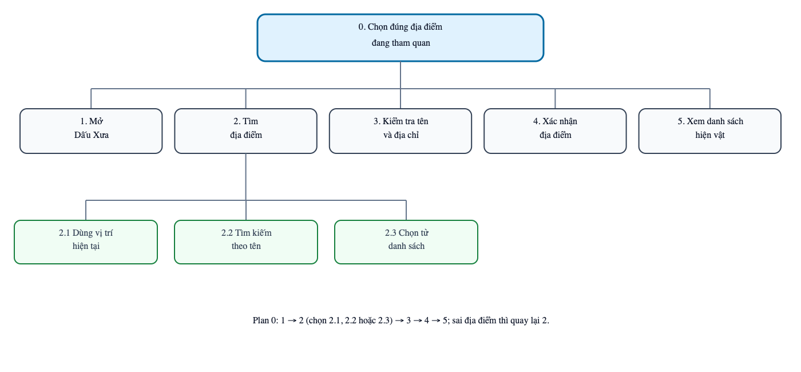{ width=95% }

Hình 1. HTA chọn địa điểm.

### HTA 2: Mở đúng nội dung của một hiện vật cho M2

QR, mã và danh sách cùng dẫn đến hiện vật; có lối quay lại khi lỗi.

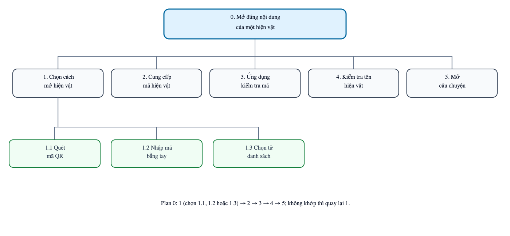{ width=95% }

Hình 2. HTA mở hiện vật.

### HTA 3: Nghe câu chuyện ngắn có âm thanh và hình ảnh cho M3

Lời kể đi cùng hình ảnh; bản chép lời là phương án thay thế.

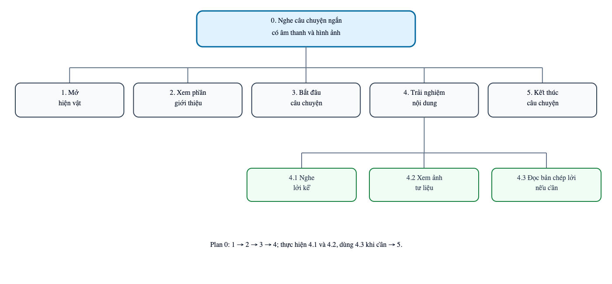{ width=95% }

Hình 3. HTA nghe câu chuyện.

### HTA 4: Điều khiển trình phát câu chuyện cho M4

Điều khiển phát, dừng và tua có thể lặp lại trong cùng màn hình.

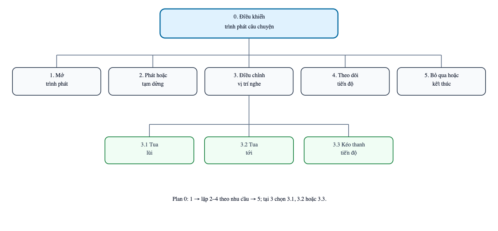{ width=95% }

Hình 4. HTA điều khiển trình phát.

### HTA 5: Truy cập mô tả của hiện vật và hình ảnh cho M5

Mô tả bằng chữ đã có; bản thu mô tả riêng chưa hoàn thành.

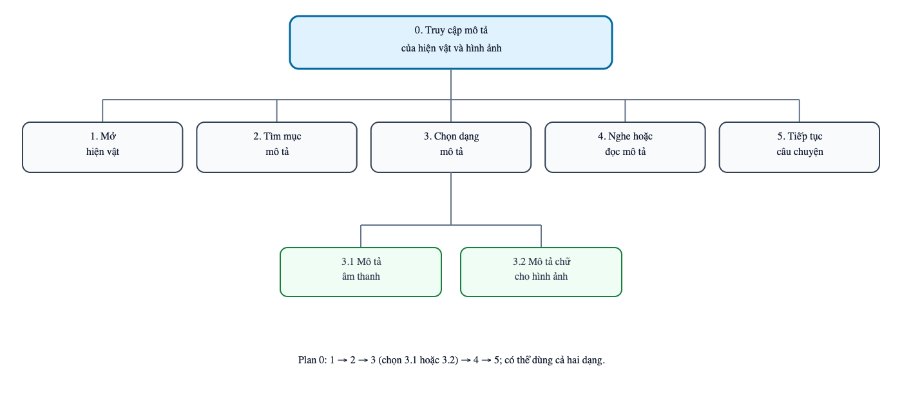{ width=95% }

Hình 5. HTA truy cập mô tả.

### HTA 6: Hoàn thành luồng chính bằng trình đọc màn hình cho M6

Nhãn và thứ tự tiêu điểm cần kiểm thử với VoiceOver/TalkBack.

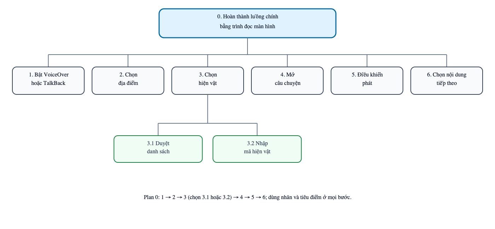{ width=95% }

Hình 6. HTA dùng trình đọc màn hình.

### HTA 7: Thiết lập và sử dụng tín hiệu rung cho M7

Công tắc rung chỉ là minh họa; rung theo mốc chưa triển khai.

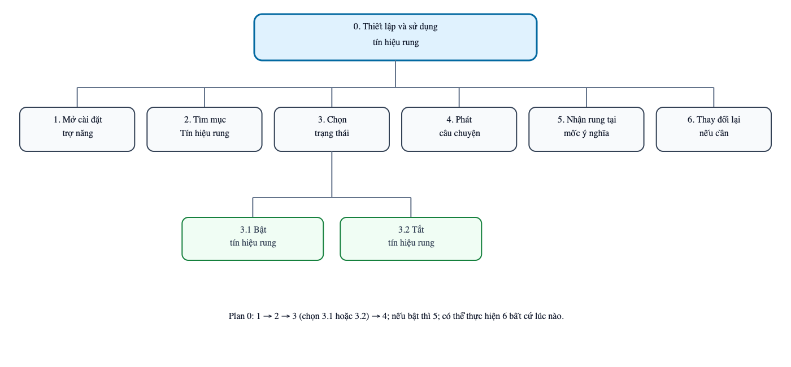{ width=95% }

Hình 7. HTA thiết lập rung.

### HTA 8: Kiểm tra nguồn của nội dung lịch sử cho M8

Người dùng mở mục Nguồn rồi trở lại câu chuyện; nguồn thật chưa bổ sung.

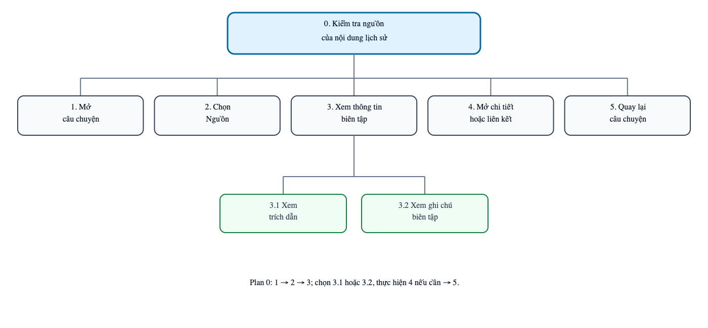{ width=95% }

Hình 8. HTA kiểm tra nguồn.

### HTA 9: Mua và trải nghiệm Premium Historical Tour

Xem giá, nghe thử, mua và theo tuyến; AR luôn có phương án thay thế. Thanh toán đang mô phỏng.

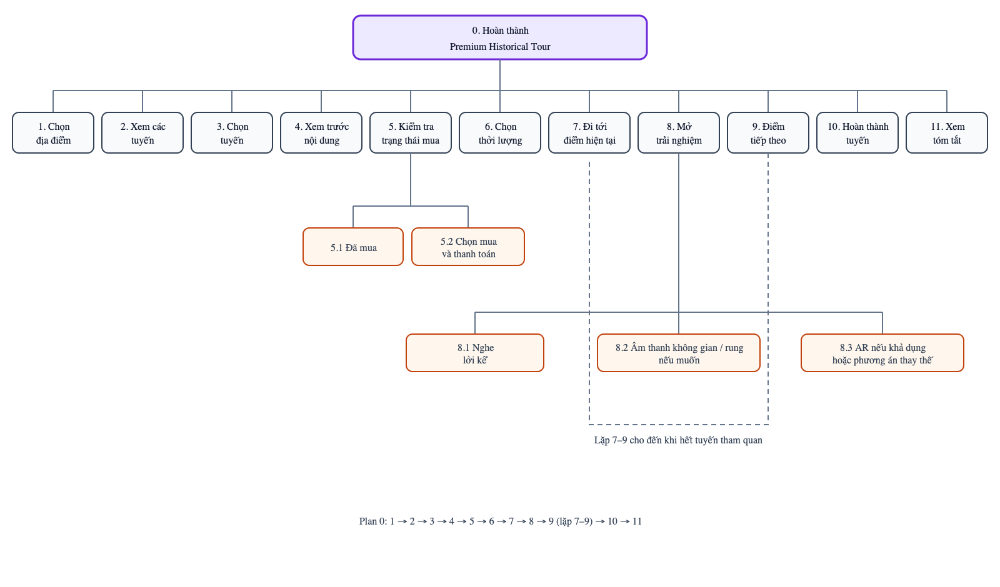{ width=95% }

Hình 9. HTA tour trả phí.

## 2.5. Kiến trúc thông tin và phác thảo độ trung thực thấp

### 2.5.1. Sitemap và điều hướng

Sáu khu vực gồm Khởi động, Khám phá, Tour, Đã lưu, Cá nhân và Trợ năng. Thanh dưới dẫn đến bốn khu vực chính; thiết lập trợ năng dùng xuyên suốt.

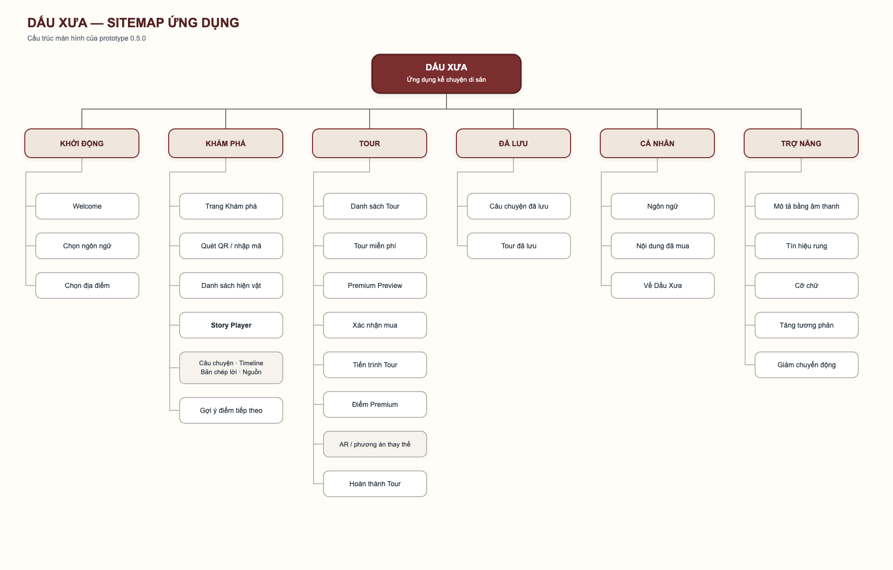{ width=95% }

Hình 10. Sitemap của ứng dụng.

### 2.5.2. Bản phác thảo số low-fi dựa trên HTA

Ba phác thảo số mô tả luồng miễn phí, trợ năng và Premium. Chúng chưa thay cho bản vẽ tay trên giấy hoặc wireframe medium-fi.

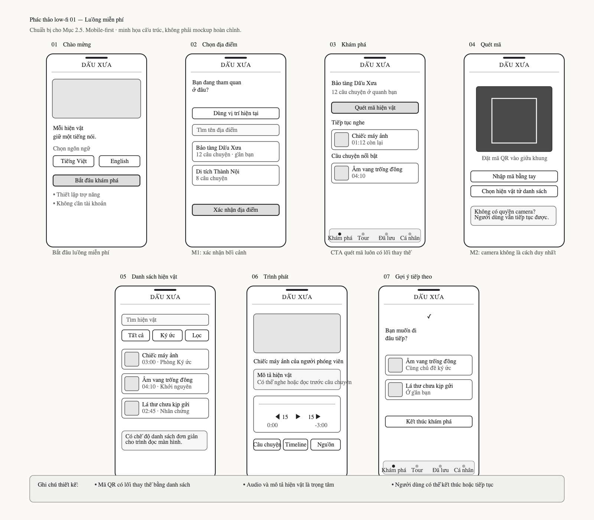{ width=95% }

Hình 11. Phác thảo luồng miễn phí.

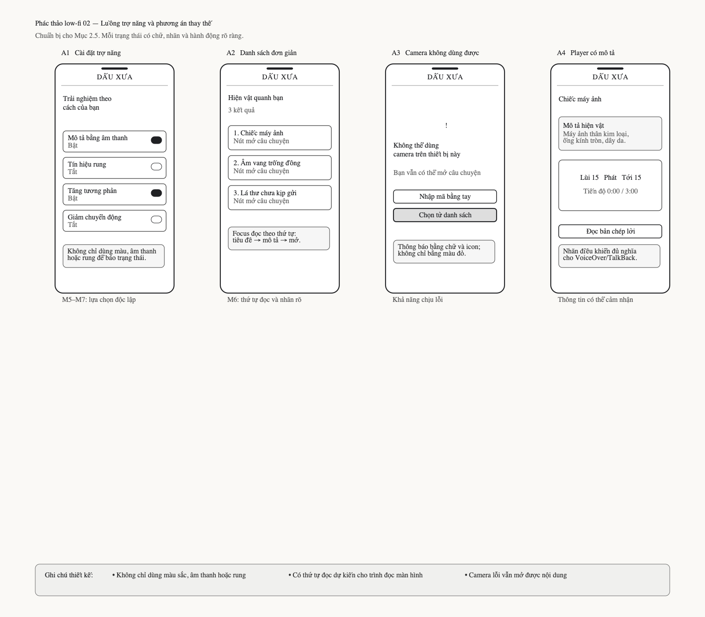{ width=95% }

Hình 12. Phác thảo trợ năng.

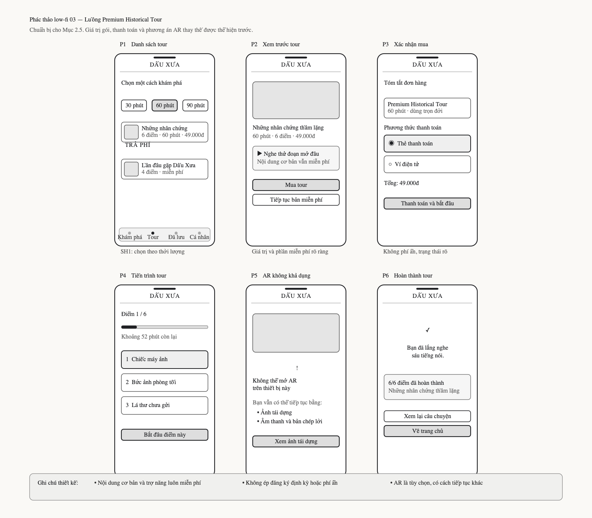{ width=95% }

Hình 13. Phác thảo tour trả phí.

## 2.6. Rà soát và điều chỉnh giao diện theo nguyên tắc khả dụng

Đánh giá theo 10 nguyên tắc của Nielsen dẫn đến ba điều chỉnh chính: thêm lối danh sách khi QR lỗi, hiển thị trạng thái trình phát, và đặt giá cùng phần nghe thử trước xác nhận mua. Đây là rà soát thiết kế, chưa phải kiểm thử với người dùng.

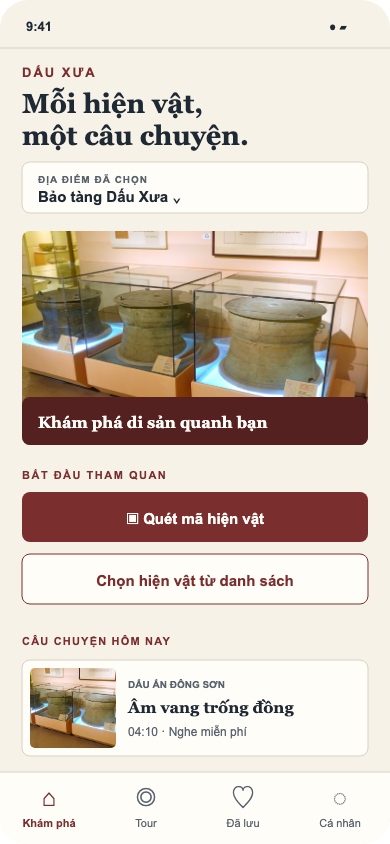{ width=42% } 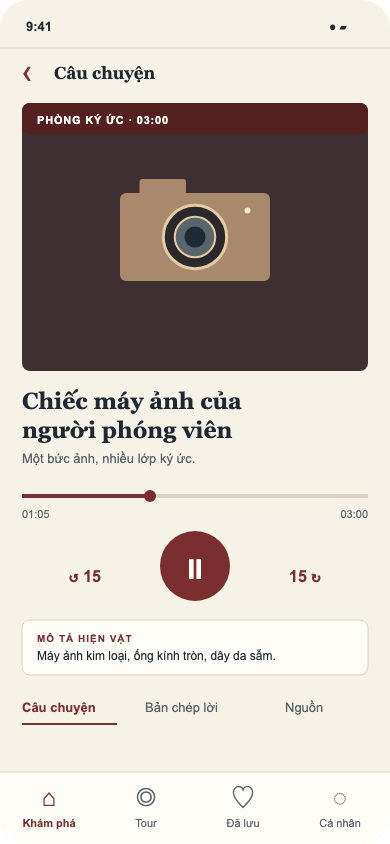{ width=42% }

Hình 14. Mockup Figma: mở hiện vật và nghe chuyện miễn phí.

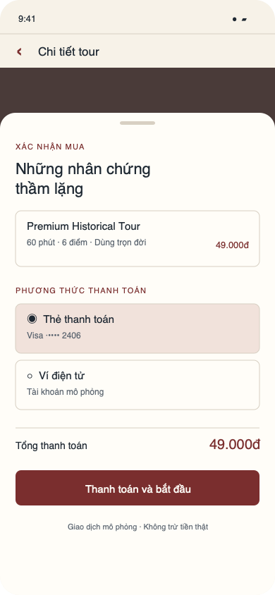{ width=42% } 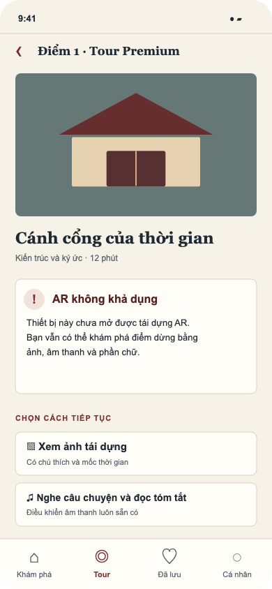{ width=42% }

Hình 15. Mockup Figma: giá trước khi mua và lối tiếp tục khi AR lỗi.

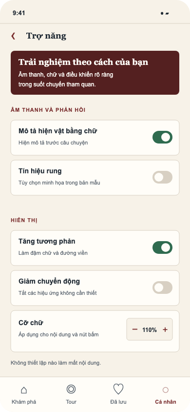{ width=42% } 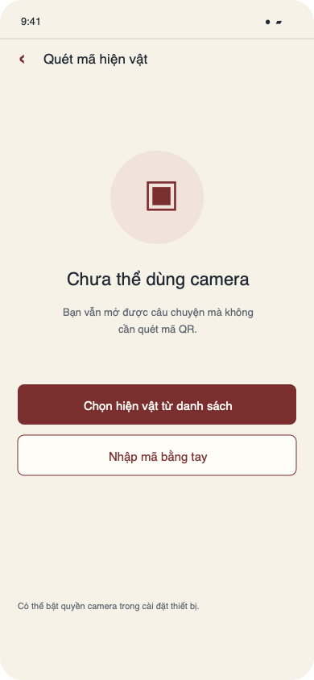{ width=42% }

Hình 16. Mockup Figma: thiết lập trợ năng và lối mở không dùng camera.

Bản thử nghiệm 0.5.1 chỉ có bốn chuyện mẫu; vị trí, QR, thanh toán, ngoại tuyến, AR và rung được mô phỏng. Tour mới có một điểm tương tác; chưa có bản chép lời khớp âm thanh, nguồn lịch sử thật hoặc kiểm thử VoiceOver/TalkBack. Vì vậy, chưa thể kết luận sản phẩm đáp ứng đầy đủ các yêu cầu tiếp cận và nội dung.

## 2.7. Liên kết xem thiết kế và bản thử nghiệm

- [Mockup Figma mức cao: 22 màn hình](https://www.figma.com/design/fYqJNkIZOrHHubt2pVu7Y5).
- [Phác thảo Figma low-fi: ba luồng](https://www.figma.com/design/Hswz66mX3mCWBZLek8EF2o).
- Demo trực tuyến: chưa ghi nhận liên kết công khai.
- [Mã nguồn Dấu Xưa trên GitHub](https://github.com/minhtien0498/IT2019.11.CH-Dau-Xua).

# Tài liệu tham khảo

Apple App Store (2026a), *Smartify: Arts and Culture*. Truy cập ngày 19/09/2026 tại <https://apps.apple.com/gb/app/smartify-arts-and-culture/id1102736524>.

Apple App Store (2026b), *Connects: Arts+Culture*. Truy cập ngày 19/09/2026 tại <https://apps.apple.com/us/app/connects-arts-culture/id1476456847>.

Bloomberg Connects (2026), *Bloomberg Connects*. Truy cập ngày 12/09/2026 tại <https://www.bloombergconnects.org/>.

Nielsen, Jakob (1994, rà soát năm 2024), *10 Usability Heuristics for User Interface Design*. Nielsen Norman Group. Truy cập ngày 03/10/2026 tại <https://www.nngroup.com/articles/ten-usability-heuristics/>.

Smartify (2026), *Smartify: Arts and Culture*. Truy cập ngày 12/09/2026 tại <https://play.google.com/store/apps/details?id=com.mobgen.smartify>.

Vi Chi Thanh (2026a), *Week 2: Introduction to User-Centred Design Methods*. Tài liệu môn học, University of Information Technology và Birmingham City University.

Vi Chi Thanh (2026b), *Week 3: Introduction to Accessibility and Inclusive Design*. Tài liệu môn học, University of Information Technology và Birmingham City University.

W3C Web Accessibility Initiative (2024a), *How People with Disabilities Use the Web*. Truy cập ngày 12/09/2026 tại <https://www.w3.org/WAI/people-use-web/>.

W3C Web Accessibility Initiative (2024b), *Involving Users in Web Projects for Better, Easier Accessibility*. Truy cập ngày 12/09/2026 tại <https://www.w3.org/WAI/planning/involving-users/>.
