# Lịch sử thay đổi

| Phiên bản | Ngày thay đổi | Người thực hiện | Nội dung thay đổi | Ghi chú |
|---|---|---|---|---|
| 1.0 | 19/09/2026 | Tô Huỳnh Minh Tiến | Hoàn thiện báo cáo đến Mục 2.4. | Bản nộp trước. |
| 1.1 | 03/10/2026 | Tô Huỳnh Minh Tiến | Bổ sung Phụ lục A: rà soát 10 nguyên tắc, bảng 8 thay đổi trước–sau và 4 ảnh minh chứng. | Bài tập 4. |

# 1. Giới thiệu

## 1.1. Ý tưởng dự án

Dấu Xưa là ứng dụng di động hỗ trợ khách tham quan tìm hiểu bảo tàng, di tích lịch sử và di sản văn hóa ngay tại địa điểm. Thay vì chỉ đọc bảng thuyết minh, người dùng có thể quét mã QR hoặc chọn hiện vật từ danh sách để nghe một câu chuyện ngắn, xem ảnh tư liệu, nhận tín hiệu rung ở những đoạn quan trọng và khám phá nội dung liên quan.

Vấn đề dự án muốn giải quyết là việc khách tham quan khó kết nối với câu chuyện phía sau hiện vật. Thông tin tại nhiều địa điểm thường dài, có nhiều mốc thời gian hoặc dựa nhiều vào hình ảnh. Người có ít thời gian khó biết nên xem gì trước; trẻ em dễ mất tập trung; người khiếm thị đôi khi phải nhờ người đi cùng đọc và mô tả nội dung. Vì vậy, Dấu Xưa lấy lời kể bằng âm thanh làm hình thức chính, kết hợp ảnh tư liệu, tín hiệu rung, bản chép lời và mô tả âm thanh.

Dự án tập trung vào trải nghiệm trên điện thoại khi người dùng đang có mặt tại địa điểm tham quan. Bản đồ và chỉ đường chỉ đóng vai trò hỗ trợ. Ứng dụng không cung cấp dịch vụ đặt vé, khách sạn, nhà hàng, mạng xã hội hoặc nội dung lịch sử do AI tự tạo. Trước khi đưa vào sản phẩm, nội dung lịch sử phải được biên tập và ghi rõ nguồn.

## 1.2. Người dùng mục tiêu

Dự án tập trung vào ba nhóm người dùng chính:

Nhóm 1: Sinh viên và người trẻ thường đi tham quan cùng bạn bè. Họ quen sử dụng điện thoại thông minh, thích nội dung ngắn, trực quan và muốn nắm nhanh những điểm đáng nhớ mà vẫn theo kịp hoạt động của nhóm.

Nhóm 2: Phụ huynh đi cùng gia đình thường có ít thời gian và cần một lộ trình rõ ràng, với nội dung phù hợp cho nhiều độ tuổi.

Nhóm 3: Người khiếm thị sử dụng VoiceOver hoặc TalkBack. Họ cần tìm, mở và điều khiển nội dung mà không phải dựa vào hình ảnh; phần mô tả hiện vật nên xuất hiện trước câu chuyện chính.

Một người dùng không thể đại diện cho trải nghiệm của tất cả người khiếm thị. W3C khuyến nghị mời người khuyết tật tham gia trong suốt quá trình thiết kế, bên cạnh việc xây dựng chân dung người dùng, kịch bản và quy trình tác vụ. Vì vậy, các giả định trong báo cáo vẫn cần được kiểm chứng bằng phỏng vấn và thử nghiệm với người dùng thật.

## 1.3. Chức năng của ứng dụng

Ở phiên bản miễn phí, người dùng chọn địa điểm, quét mã QR hoặc chọn hiện vật rồi mở trình phát câu chuyện. Nội dung gồm lời kể, hình ảnh, mô tả âm thanh, bản chép lời và nguồn tham khảo. Người dùng có thể phát, tạm dừng, tua, tắt tín hiệu rung và xem gợi ý cho điểm tham quan tiếp theo.

Các chức năng hỗ trợ gồm tuyến tham quan 30, 60 hoặc 90 phút, tuyến theo chủ đề, dòng thời gian ngắn, lưu nội dung yêu thích, xem lại và thay đổi ngôn ngữ. Khả năng tiếp cận là một phần của phiên bản miễn phí: ứng dụng hỗ trợ trình đọc màn hình, tăng cỡ chữ, tăng độ tương phản, giảm chuyển động và không dùng màu sắc làm dấu hiệu duy nhất.

Premium Historical Tour là tính năng trả phí chính. Mỗi gói là một tuyến tham quan đã được biên tập, kết nối câu chuyện ở nhiều điểm và có thể bổ sung âm thanh không gian, nội dung ngoại tuyến hoặc AR. Trước khi mua, người dùng được nghe thử, xem giá và biết rõ gói trải nghiệm bao gồm những gì. Nếu thiết bị không hỗ trợ AR, họ vẫn có thể tiếp tục bằng ảnh tái dựng, âm thanh và bản chép lời. Thông tin lịch sử cơ bản, phần mô tả âm thanh và các chức năng tiếp cận vẫn được cung cấp miễn phí.

## 1.4. Phân tích đối thủ

Hai sản phẩm được dùng để tham khảo là Smartify và Bloomberg Connects. Cả hai đều đưa nội dung văn hóa lên thiết bị di động, nhưng cách tổ chức trải nghiệm và phạm vi nội dung khác với Dấu Xưa.

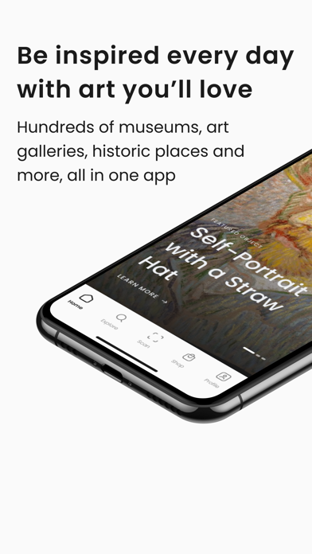{ width=22% } 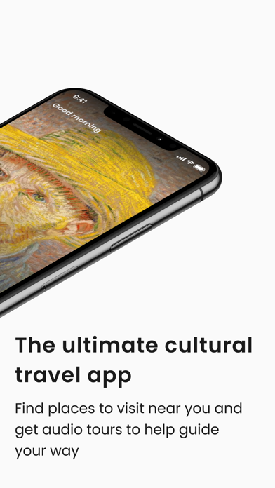{ width=22% } 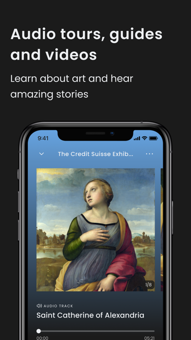{ width=22% } 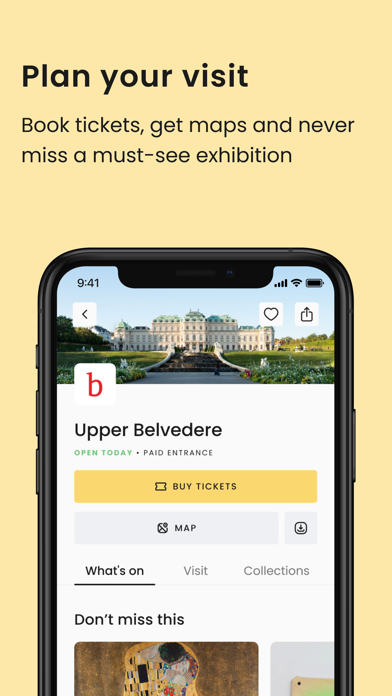{ width=22% }

Hình 1. Một số màn hình giới thiệu của Smartify. Nguồn ảnh: Apple App Store.

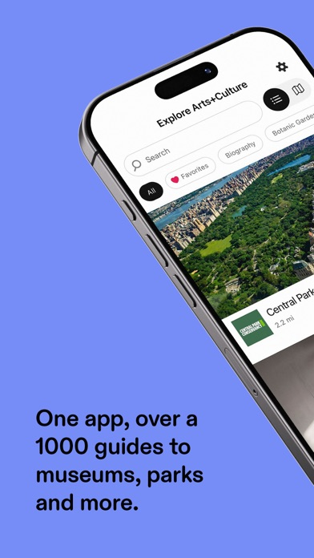{ width=22% } 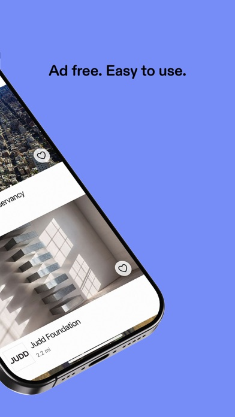{ width=22% } 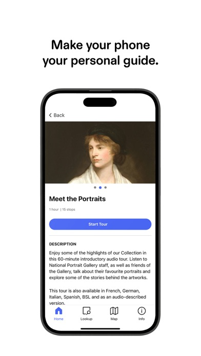{ width=22% } 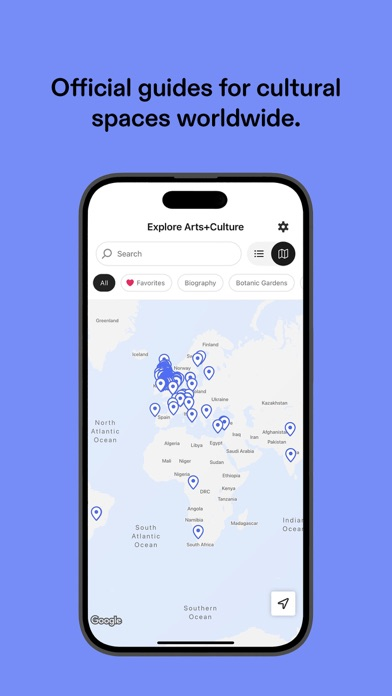{ width=22% }

Hình 2. Một số màn hình giới thiệu của Bloomberg Connects. Nguồn ảnh: Apple App Store.

| Tiêu chí | Smartify | Bloomberg Connects | Hàm ý cho Dấu Xưa |
|---|---|---|---|
| Giá trị chính | Khám phá bảo tàng hoặc phòng trưng bày, nhận diện tác phẩm và nghe thuyết minh. | Cung cấp hướng dẫn tham quan miễn phí do các tổ chức văn hóa biên soạn. | Giúp người dùng mở nội dung tại chỗ nhanh, đồng thời kết nối các điểm thành một câu chuyện rõ ràng. |
| Điểm mạnh có thể học hỏi | Khả năng nhận diện hiện vật và thuyết minh bằng âm thanh giúp giảm thao tác tìm kiếm. | Hỗ trợ VoiceOver, phụ đề, bản chép lời, phóng to hình ảnh và điều chỉnh cỡ chữ. | Xem khả năng tiếp cận là yêu cầu cốt lõi; luôn có cách mở nội dung thay cho máy ảnh và có bản chép lời cho âm thanh. |
| Khoảng trống mà Dấu Xưa tập trung | Nội dung nghiêng về nghệ thuật và phụ thuộc vào các đối tác đã tham gia; ứng dụng không thể nhận diện mọi hiện vật. | Nội dung của mỗi hướng dẫn phụ thuộc vào từng tổ chức; ứng dụng không tập trung vào kể chuyện bằng rung hoặc tuyến tái dựng trả phí. | Tập trung vào lịch sử và di sản Việt Nam, kể chuyện ngay tại địa điểm, dùng rung có chọn lọc và luôn có phương án thay thế AR. |

Theo thông tin do Smartify công bố, ứng dụng có thể nhận diện tác phẩm hoặc hiện vật, tìm địa điểm và phát thuyết minh; tuy nhiên, khả năng nhận diện còn phụ thuộc vào quan hệ đối tác và bản quyền. Bloomberg Connects cung cấp VoiceOver, phụ đề, bản chép lời cho âm thanh, phóng to hình ảnh và điều chỉnh cỡ chữ. Phần so sánh trong bảng dựa trên các chức năng mà hai sản phẩm công bố, chưa phải kết quả kiểm thử trực tiếp với người dùng.

Dấu Xưa không đặt mục tiêu cạnh tranh bằng số lượng bộ sưu tập. Điểm khác biệt dự kiến là cách kể chuyện ngắn gọn tại các di sản Việt Nam: nội dung cơ bản dễ mở và luôn miễn phí, còn gói trả phí cung cấp tuyến tham quan chuyên sâu, âm thanh không gian, nội dung ngoại tuyến và AR tùy chọn. Điểm khác biệt này vẫn cần được kiểm chứng với người dùng.

# 2. Thiết kế trải nghiệm người dùng

Thiết kế lấy người dùng làm trung tâm, viết tắt là UCD, là quá trình lặp, trong đó nhu cầu và bối cảnh sử dụng được xem xét ở từng giai đoạn. Theo nội dung môn học, quá trình này gồm tìm hiểu người dùng và bối cảnh, xác định yêu cầu, đề xuất giải pháp, đánh giá rồi tiếp tục điều chỉnh.

Trong báo cáo này, chân dung và kịch bản ở Mục 2.1–2.2 được dùng để xác định người dùng, bối cảnh, mục tiêu và khó khăn của họ. Từ đó, các yêu cầu được sắp xếp theo phương pháp MoSCoW ở Mục 2.3 và được cụ thể hóa thành các sơ đồ HTA ở Mục 2.4. Đây mới là những giả định ban đầu và cần được kiểm chứng với người dùng thật.

## 2.1. Chân dung người dùng

Chân dung người dùng là hình mẫu được xây dựng từ những đặc điểm, mục tiêu và nhu cầu thường gặp của một nhóm đối tượng. Công cụ này giúp nhóm thiết kế xác định rõ sản phẩm đang phục vụ ai, thay vì hình dung chung chung về một “người dùng trung bình”. Báo cáo xây dựng ba chân dung; trong đó Chân dung 3 là người khiếm thị, theo yêu cầu của bài tập.

### Chân dung 1: Minh, sinh viên

| Thuộc tính | Mô tả |
|---|---|
| Tuổi, nghề nghiệp, nơi sống | 21 tuổi; sinh viên năm ba; sống tại TP.HCM. |
| Tính cách | Tò mò, cởi mở, thích khám phá và chia sẻ trải nghiệm với bạn bè. |
| Thiết bị và thói quen | Dùng điện thoại thông minh thường xuyên; quen Google Maps, TikTok và Instagram; thường xem nội dung ngắn thay vì đọc bài dài. |
| Bối cảnh | Tham quan cùng bạn, thời gian dừng ở mỗi điểm ngắn và không muốn nhìn màn hình liên tục. |
| Động lực | Muốn hiểu nhanh câu chuyện đáng nhớ nhất của địa điểm. |
| Mục tiêu | Mở đúng nội dung ngay tại hiện vật; nghe một câu chuyện trong 2–3 phút; biết điểm nào nên xem tiếp. |
| Rào cản / thất vọng | Bảng thuyết minh dài, nhiều tên và mốc thời gian; khó hình dung sự kiện chỉ từ chữ và ảnh tĩnh. |
| Nhu cầu từ Dấu Xưa | Mã QR hoặc danh sách hiện vật; câu chuyện ngắn; lời kể bằng âm thanh; ảnh tư liệu; rung có chọn lọc; gợi ý điểm tiếp theo. |

### Chân dung 2: Hương, phụ huynh tham quan cùng gia đình

| Thuộc tính | Mô tả |
|---|---|
| Tuổi, nghề nghiệp, nơi sống | 36 tuổi; nhân viên văn phòng; sống tại TP.HCM. |
| Tính cách | Có kế hoạch, thực tế; thích hoạt động vừa giải trí vừa giúp con học thêm. |
| Thiết bị và thói quen | Lên kế hoạch bằng điện thoại, đọc đánh giá và xem trước thời lượng tham quan. |
| Bối cảnh | Đi cùng chồng và con; chỉ có 45–90 phút tại một địa điểm. |
| Động lực | Muốn cả gia đình hiểu được những câu chuyện chính trong thời gian tham quan có hạn. |
| Mục tiêu | Chọn lộ trình phù hợp với thời gian, giữ được sự chú ý của trẻ và cân nhắc mua nội dung chuyên sâu khi lợi ích được trình bày rõ. |
| Rào cản / thất vọng | Không biết nên đi tuyến nào; trẻ dễ chán nếu chỉ đọc; nội dung tại chỗ đôi khi quá học thuật. |
| Nhu cầu từ Dấu Xưa | Tuyến tham quan theo thời lượng; ngôn ngữ dễ hiểu; xem trước nội dung trả phí; thanh toán ngắn gọn; phần tóm tắt sau chuyến tham quan. |

### Chân dung 3: Nam, người khiếm thị

| Thuộc tính | Mô tả |
|---|---|
| Tuổi, nghề nghiệp, nơi sống | 29 tuổi; nhân viên văn phòng; sống tại TP.HCM; khiếm thị nặng. |
| Tính cách | Độc lập, kiên nhẫn; thích lịch sử, chương trình âm thanh và các sản phẩm có khả năng tiếp cận tốt. |
| Thiết bị và thói quen | Dùng iPhone hoặc Android với VoiceOver/TalkBack; thường dùng tai nghe. |
| Bối cảnh | Tham quan cùng bạn hoặc tự trải nghiệm một phần nội dung trong không gian đông người. |
| Động lực | Muốn chủ động khám phá bảo tàng và giảm việc phải nhờ người khác đọc hoặc mô tả. |
| Mục tiêu | Biết mình đang nghe về hiện vật nào; nghe mô tả hình dáng trước câu chuyện; điều khiển toàn bộ luồng bằng trình đọc màn hình. |
| Rào cản / thất vọng | Thông tin chủ yếu là chữ và hình; khó biết hiện vật nào ở gần; mã QR và máy ảnh có thể khó tự thao tác. |
| Nhu cầu từ Dấu Xưa | Danh sách thay cho mã QR; mô tả âm thanh; nhãn rõ cho trình đọc màn hình; nút lớn; tín hiệu rung đơn giản và có thể tắt. |

## 2.2. Kịch bản người dùng

Kịch bản người dùng mô tả một tình huống cụ thể trong đó người dùng tương tác với sản phẩm để đạt mục tiêu. Qua kịch bản, nhóm thiết kế có thể nhận ra bối cảnh, nhu cầu, động lực, thói quen và những trở ngại cần lưu ý. Ba kịch bản dưới đây tương ứng với ba chân dung người dùng; Kịch bản 3 tập trung vào tính năng trả phí theo yêu cầu của bài tập.

### Kịch bản 1: Minh khám phá nhanh một hiện vật

Minh cùng nhóm bạn đến một di tích lịch sử. Sau khi chụp ảnh, Minh muốn biết nơi mình đang đứng từng diễn ra sự kiện gì nhưng không muốn đọc một bảng thông tin dài. Minh mở Dấu Xưa, chọn địa điểm hiện tại và quét mã QR bên cạnh hiện vật. Nếu máy ảnh không hoạt động, Minh có thể nhập mã hoặc chọn hiện vật từ danh sách. Ứng dụng phát một câu chuyện dài khoảng 2–3 phút, kết hợp lời kể, ảnh tư liệu và một vài tín hiệu rung ở những đoạn quan trọng. Khi câu chuyện kết thúc, ứng dụng gợi ý hai điểm gần đó để Minh tiếp tục tham quan.

Mục tiêu của Minh là mở đúng câu chuyện và hiểu ý chính trong thời gian ngắn.

Từ tình huống này, ứng dụng cần giúp người dùng mở câu chuyện nhanh, không buộc họ nhìn màn hình liên tục. Trình phát phải có các nút phát, tạm dừng, tua, bỏ qua và xem nguồn; tín hiệu rung chỉ xuất hiện khi cần thiết; đồng thời phải có cách mở hiện vật mà không dùng máy ảnh.

### Kịch bản 2: Nam tham quan bằng trình đọc màn hình

Nam đến một bảo tàng và bật chế độ hỗ trợ tiếp cận. Anh duyệt danh sách hiện vật gần đó bằng VoiceOver hoặc TalkBack thay vì dùng máy ảnh. Khi Nam chọn một hiện vật, ứng dụng đọc tên, mô tả hình dáng và bối cảnh trước khi phát câu chuyện. Tín hiệu rung đơn giản báo hiệu khi nội dung chuyển phần, nhưng Nam có thể tắt nếu không muốn dùng. Sau khi nghe xong, anh chuyển tiêu điểm đến gợi ý tiếp theo và mở nội dung mới mà không cần dựa vào hình ảnh hoặc màu sắc.

Mục tiêu của Nam là chủ động nhận biết và khám phá hiện vật bằng công nghệ hỗ trợ.

Từ tình huống này, toàn bộ luồng chính phải dùng được với trình đọc màn hình. Các nút cần có tên rõ, tiêu điểm phải di chuyển theo thứ tự hợp lý, phần mô tả hiện vật cần tách khỏi câu chuyện chính và không được dùng màu sắc, âm thanh hoặc rung làm dấu hiệu duy nhất.

### Kịch bản 3: Hương mua và sử dụng Premium Historical Tour

Hương chỉ có một giờ tham quan cùng gia đình nên chọn tuyến 60 phút. Ứng dụng giới thiệu Premium Historical Tour “Những nhân chứng thầm lặng”, gồm sáu điểm dừng. Trước khi mua, Hương xem lộ trình, nội dung của gói, giá và nghe thử một đoạn. Sau khi thanh toán, gia đình đi theo tuyến đã được biên tập. Tại mỗi điểm, ứng dụng phát câu chuyện dài hơn và gợi ý trải nghiệm âm thanh không gian hoặc AR. Nếu AR không hoạt động trên thiết bị, gia đình vẫn có thể tiếp tục bằng ảnh tái dựng, âm thanh và bản chép lời. Cuối chuyến tham quan, ứng dụng tóm tắt các mốc chính và lưu những điểm đã xem.

Mục tiêu của Hương là hoàn thành một tuyến tham quan chuyên sâu trong một giờ mà cả gia đình đều có thể theo dõi.

Từ tình huống này, trang giới thiệu tuyến tham quan cần nêu rõ nội dung và giá trước khi mua. Quy trình thanh toán và bắt đầu phải ngắn gọn, tiến độ cần được hiển thị rõ, còn AR chỉ là lựa chọn bổ sung và luôn có phương án thay thế. Thông tin lịch sử cơ bản vẫn phải được cung cấp miễn phí.

## 2.3. Yêu cầu người dùng

Yêu cầu người dùng cho biết sản phẩm cần hỗ trợ điều gì để phù hợp với nhu cầu thực tế. Phương pháp MoSCoW xếp các yêu cầu vào bốn nhóm. Must Have là những yêu cầu bắt buộc phải có; Should Have là những yêu cầu nên có; Could Have là những yêu cầu có thể bổ sung; còn Won’t Have là những yêu cầu chưa thực hiện trong phạm vi hiện tại. Danh sách dưới đây được rút ra từ mục tiêu và khó khăn trong ba kịch bản người dùng.

### Bắt buộc phải có (Must Have)

| Mã | Yêu cầu | Nguồn |
|---|---|---|
| M1 | Người dùng có thể chọn đúng bảo tàng hoặc di tích đang tham quan. | Kịch bản 1, 2 |
| M2 | Người dùng có thể mở hiện vật bằng mã QR, nhập mã hoặc chọn từ danh sách; máy ảnh không phải là cách duy nhất. | Kịch bản 1, 2 |
| M3 | Mỗi hiện vật có một câu chuyện ngắn, kết hợp lời kể bằng âm thanh và hình ảnh. | Kịch bản 1 |
| M4 | Trình phát câu chuyện có chức năng phát, tạm dừng, tua, bỏ qua và hiển thị tiến độ. | Kịch bản 1, 2 |
| M5 | Hình ảnh quan trọng có mô tả bằng chữ; hiện vật có phần mô tả âm thanh tách khỏi câu chuyện chính. | Kịch bản 2 |
| M6 | Luồng chính và các nút điều khiển tương thích với VoiceOver/TalkBack; thông tin không chỉ được thể hiện bằng màu sắc, hình ảnh, âm thanh hoặc rung. | Kịch bản 2 |
| M7 | Người dùng có thể tắt tín hiệu rung; ứng dụng chỉ rung ở những mốc nội dung có ý nghĩa. | Kịch bản 1, 2 |
| M8 | Nội dung lịch sử hiển thị nguồn tham khảo hoặc ghi chú biên tập. | Kịch bản 1 |

### Nên có (Should Have)

| Mã | Yêu cầu | Nguồn |
|---|---|---|
| SH1 | Tuyến tham quan theo thời lượng 30, 60 hoặc 90 phút. | Kịch bản 3 |
| SH2 | Tuyến tham quan theo chủ đề và gợi ý điểm tiếp theo. | Kịch bản 1, 3 |
| SH3 | Lưu nội dung yêu thích, xem lại và xem dòng thời gian ngắn. | Kịch bản 1, 3 |
| SH4 | Hỗ trợ đa ngôn ngữ. | Nhóm khách tham quan |
| SH5 | Premium Historical Tour cho phép xem trước nội dung, hiển thị rõ giá và phạm vi của gói, có quy trình thanh toán ngắn gọn và phần tóm tắt sau khi hoàn thành. | Kịch bản 3 |

### Có thể có (Could Have)

| Mã | Yêu cầu | Nguồn |
|---|---|---|
| C1 | Câu hỏi ngắn từ 1–3 câu, chế độ trẻ em và huy hiệu hoàn thành chuyến tham quan. | Chân dung 2 |
| C2 | Tái dựng bằng AR tại một số điểm trả phí, luôn kèm ảnh, âm thanh và bản chép lời thay thế. | Kịch bản 3 |
| C3 | Âm thanh không gian và gói nội dung ngoại tuyến cho tuyến tham quan trả phí. | Kịch bản 3 |
| C4 | Chia sẻ câu chuyện hoặc địa điểm. | Chân dung 1 |

### Chưa thực hiện trong phạm vi hiện tại (Won’t Have)

| Mã | Yêu cầu | Lý do |
|---|---|---|
| W1 | Mạng xã hội hoặc trò chuyện trực tuyến. | Không phục vụ mục tiêu khám phá tại chỗ. |
| W2 | Đặt khách sạn, nhà hàng, chuyến bay hoặc vé du lịch. | Làm sản phẩm thành ứng dụng du lịch tổng hợp. |
| W3 | Trải nghiệm bắt buộc dùng kính thực tế ảo. | Không phù hợp với phạm vi ứng dụng trên điện thoại. |
| W4 | AI tự sinh hoặc người dùng tự đăng nội dung lịch sử. | Rủi ro sai lệch và khó kiểm soát độ tin cậy. |

Trong phạm vi hiện tại, khả năng tiếp cận và thông tin lịch sử cơ bản thuộc nhóm bắt buộc phải có và luôn được cung cấp miễn phí. Tính năng trả phí được xếp vào nhóm nên có như một gói trải nghiệm mở rộng. Các công nghệ như AR, âm thanh không gian và nội dung ngoại tuyến nằm trong nhóm có thể có để người dùng vẫn hoàn thành được chuyến tham quan nếu thiết bị không hỗ trợ các chức năng này.

## 2.4. Phân tích nhiệm vụ theo thứ bậc (HTA)

Phân tích nhiệm vụ theo thứ bậc là kỹ thuật chia một mục tiêu thành các nhiệm vụ và nhiệm vụ con. Qua đó, nhóm thiết kế có thể xem lại thứ tự thao tác, các hướng thay thế và những bước còn rườm rà. Theo yêu cầu đánh giá tiến độ, mỗi chức năng thuộc nhóm bắt buộc phải có cần một sơ đồ HTA; bài tập trên lớp cũng yêu cầu mô tả cách người dùng tương tác với chức năng miễn phí và trả phí. Vì vậy, HTA 1–8 tương ứng với M1–M8, còn HTA 9 mô tả Premium Historical Tour.

### HTA 1: Chọn đúng địa điểm đang tham quan cho M1

Mục tiêu 0: Chọn đúng bảo tàng hoặc di tích đang tham quan.

1. Mở Dấu Xưa.
2. Tìm địa điểm.
   1. Dùng vị trí hiện tại.
   2. Hoặc tìm kiếm theo tên.
   3. Hoặc chọn từ danh sách địa điểm.
3. Kiểm tra tên và địa chỉ của địa điểm.
4. Xác nhận địa điểm.
5. Xem danh sách hiện vật tại địa điểm đó.

Plan 0: Thực hiện lần lượt các bước 1, 2, 3, 4 và 5. Tại bước 2, chọn 2.1, 2.2 hoặc 2.3; nếu tên hoặc địa chỉ không khớp thì quay lại bước 2.

{ width=95% }

### HTA 2: Mở đúng nội dung của một hiện vật cho M2

Mục tiêu 0: Mở đúng nội dung của một hiện vật mà không bắt buộc phải dùng máy ảnh.

1. Chọn cách mở hiện vật.
   1. Quét mã QR.
   2. Hoặc nhập mã bằng tay.
   3. Hoặc chọn từ danh sách hiện vật.
2. Quét, nhập hoặc chọn mã nhận diện của hiện vật.
3. Ứng dụng kiểm tra mã nhận diện.
4. Kiểm tra tên và hình đại diện của hiện vật.
5. Mở câu chuyện.

Plan 0: Tại bước 1, chọn 1.1, 1.2 hoặc 1.3; sau đó thực hiện lần lượt các bước 2, 3, 4 và 5. Nếu mã không hợp lệ hoặc hiện vật không đúng thì quay lại bước 1.

{ width=95% }

### HTA 3: Nghe câu chuyện ngắn có âm thanh và hình ảnh cho M3

Mục tiêu 0: Nghe câu chuyện ngắn về một hiện vật, kết hợp âm thanh và hình ảnh.

1. Mở hiện vật.
2. Xem tên và phần giới thiệu ngắn.
3. Bắt đầu câu chuyện.
4. Trải nghiệm nội dung.
   1. Nghe lời kể.
   2. Xem ảnh tư liệu tương ứng.
   3. Đọc bản chép lời nếu cần.
5. Kết thúc câu chuyện.

Plan 0: Thực hiện lần lượt các bước 1, 2, 3, 4 và 5. Tại bước 4, thực hiện 4.1 và 4.2; dùng 4.3 khi người dùng cần đọc thay cho hoặc đồng thời với phần âm thanh.

{ width=95% }

### HTA 4: Điều khiển trình phát câu chuyện cho M4

Mục tiêu 0: Điều khiển câu chuyện đang phát và theo dõi tiến độ.

1. Mở trình phát câu chuyện.
2. Phát hoặc tạm dừng.
3. Điều chỉnh vị trí nghe.
   1. Tua lùi.
   2. Tua tới.
   3. Kéo thanh tiến độ.
4. Theo dõi thời gian và tiến độ hiện tại.
5. Bỏ qua hoặc nghe đến hết câu chuyện.

Plan 0: Thực hiện 1; lặp các bước 2–4 theo nhu cầu; sau đó thực hiện 5. Tại bước 3, chọn 3.1, 3.2 hoặc 3.3.

{ width=95% }

### HTA 5: Truy cập mô tả của hiện vật và hình ảnh cho M5

Mục tiêu 0: Truy cập mô tả hình dáng của hiện vật và các hình ảnh quan trọng.

1. Mở hiện vật.
2. Tìm mục mô tả.
3. Chọn dạng mô tả.
   1. Mô tả âm thanh của hiện vật.
   2. Mô tả chữ của hình ảnh.
4. Nghe hoặc đọc mô tả.
5. Tiếp tục nghe câu chuyện.

Plan 0: Thực hiện lần lượt các bước 1, 2, 3, 4 và 5. Tại bước 3, chọn 3.1 hoặc 3.2; người dùng có thể sử dụng cả hai dạng mô tả.

{ width=95% }

### HTA 6: Hoàn thành luồng chính bằng trình đọc màn hình cho M6

Mục tiêu 0: Hoàn thành luồng khám phá chính bằng VoiceOver hoặc TalkBack.

1. Bật VoiceOver hoặc TalkBack.
2. Chọn địa điểm bằng các điều khiển có nhãn.
3. Chọn hiện vật.
   1. Duyệt danh sách hiện vật.
   2. Hoặc nhập mã hiện vật.
4. Mở câu chuyện.
5. Điều khiển trình phát theo thứ tự tiêu điểm hợp lý.
6. Chọn nội dung tiếp theo.

Plan 0: Thực hiện lần lượt các bước 1, 2, 3, 4, 5 và 6. Tại bước 3, chọn 3.1 hoặc 3.2. Ở mọi bước, thông tin và trạng thái phải có nhãn để trình đọc màn hình nhận biết, có thứ tự tiêu điểm hợp lý và không chỉ được biểu đạt bằng màu sắc, hình ảnh, âm thanh hoặc rung.

{ width=95% }

### HTA 7: Thiết lập và sử dụng tín hiệu rung cho M7

Mục tiêu 0: Kiểm soát tín hiệu rung và chỉ nhận rung ở những đoạn nội dung có ý nghĩa.

1. Mở cài đặt trợ năng.
2. Tìm mục Tín hiệu rung.
3. Chọn trạng thái.
   1. Bật tín hiệu rung.
   2. Hoặc tắt tín hiệu rung.
4. Phát câu chuyện.
5. Nếu đã bật, nhận rung tại mốc nội dung có ý nghĩa.
6. Thay đổi lại thiết lập nếu cần.

Plan 0: Thực hiện lần lượt các bước 1, 2, 3 và 4. Nếu chọn 3.1 thì thực hiện 5; nếu chọn 3.2 thì câu chuyện tiếp tục mà không rung. Người dùng có thể thực hiện bước 6 bất cứ lúc nào.

{ width=95% }

### HTA 8: Kiểm tra nguồn của nội dung lịch sử cho M8

Mục tiêu 0: Kiểm tra nguồn hoặc ghi chú biên tập của nội dung lịch sử.

1. Mở câu chuyện.
2. Chọn mục Nguồn.
3. Xem thông tin biên tập.
   1. Xem trích dẫn nguồn.
   2. Hoặc xem ghi chú biên tập.
4. Mở chi tiết hoặc liên kết nguồn nếu cần.
5. Quay lại câu chuyện.

Plan 0: Thực hiện lần lượt các bước 1, 2 và 3. Tại bước 3, chọn 3.1 hoặc 3.2; thực hiện bước 4 nếu cần kiểm tra thêm, sau đó thực hiện bước 5.

{ width=95% }

### HTA 9: Mua và trải nghiệm Premium Historical Tour

Mục tiêu 0: Hoàn thành một Premium Historical Tour.

1. Chọn địa điểm.
2. Xem danh sách tuyến tham quan.
3. Chọn Premium Historical Tour.
4. Xem trước nội dung, giá và các quyền lợi của gói.
5. Kiểm tra trạng thái mua gói.
   1. Nếu đã mua, tiếp tục.
   2. Nếu chưa mua, chọn mua và hoàn tất thanh toán.
6. Chọn thời lượng/tuyến nếu có.
7. Đi tới điểm hiện tại.
8. Mở trải nghiệm tại điểm.
   1. Nghe lời kể.
   2. Bật âm thanh không gian hoặc tín hiệu rung nếu muốn.
   3. Mở AR nếu thiết bị hỗ trợ; nếu không, dùng ảnh, âm thanh và bản chép lời thay thế.
9. Chọn điểm tiếp theo.
10. Hoàn thành tuyến tham quan.
11. Xem tóm tắt và lưu các điểm đã tham quan.

Plan 0: Thực hiện lần lượt các bước 1 đến 9; lặp lại các bước 7–9 cho đến khi hết tuyến tham quan, sau đó thực hiện bước 10 và 11. Tại bước 5, thực hiện 5.1 nếu đã mua, ngược lại thực hiện 5.2. Tại bước 8, 8.1 luôn khả dụng; 8.2–8.3 là tùy chọn.

{ width=95% }

HTA 9 được xây dựng từ Kịch bản 3 và yêu cầu SH5. Gói trả phí bổ sung nội dung chuyên sâu nhưng không bắt buộc người dùng phải có AR, tín hiệu rung hay âm thanh không gian mới hoàn thành được tuyến tham quan.

# Phụ lục A. Cải thiện giao diện theo các nguyên tắc khả dụng

## A.1. Cách nhìn lại giao diện

Giao diện ban đầu còn ba điểm dễ thấy: nút “Danh sách đơn giản” chưa có tác dụng, hộp thoại khó thoát bằng bàn phím và lỗi nhập mã chưa rõ. Bộ 10 nguyên tắc của Jakob Nielsen được dùng để chọn cách sửa phù hợp.

Trong phần dưới, “bản trước” là giao diện trước khi rà soát, còn “bản sau” là giao diện đã chỉnh sửa.

## A.2. Áp dụng 10 nguyên tắc vào Dấu Xưa

| Nguyên tắc | Cách áp dụng trong Dấu Xưa |
|---|---|
| 1. Hiển thị trạng thái hệ thống | Hiện địa điểm, số kết quả, trạng thái phát, thời gian còn lại, tiến độ tour và phản hồi sau thao tác. |
| 2. Phù hợp với thế giới thực | Dùng các từ quen thuộc như “hiện vật”, “câu chuyện”, “điểm dừng”; tour có thời lượng và số điểm rõ ràng. |
| 3. Quyền kiểm soát và tự do | Luôn có cách quay lại, đóng hộp thoại, bỏ qua AR, dùng bản miễn phí, tắt rung hoặc hoàn tác thao tác lưu. |
| 4. Nhất quán và theo chuẩn | Nút, thanh điều hướng, thẻ nội dung và các tab dùng cùng một quy ước trên toàn ứng dụng. |
| 5. Ngăn ngừa lỗi | Không cho gửi mã rỗng; nhắc lại giá và nội dung tour trước khi thanh toán; khóa nút trong lúc xử lý. |
| 6. Nhận biết thay vì ghi nhớ | Địa điểm, bộ lọc, nội dung đang nghe và nhãn miễn phí hoặc trả phí luôn xuất hiện đúng lúc. |
| 7. Linh hoạt và hiệu quả | Có thể mở hiện vật bằng QR, nhập mã hoặc chọn danh sách; hỗ trợ đổi tốc độ nghe và cách hiển thị. |
| 8. Thẩm mỹ và tối giản | Mỗi màn hình có một hành động chính; nội dung dài được chia thành các phần ngắn, dễ quét. |
| 9. Nhận biết và phục hồi lỗi | Báo rõ khi mã sai, gợi ý cách thử lại và luôn có phương án thay thế cho camera hoặc AR. |
| 10. Trợ giúp và tài liệu | Đặt hướng dẫn ngay cạnh tác vụ và nói rõ người dùng cần làm gì tiếp theo. |

## A.3. So sánh trước và sau khi chỉnh sửa

| Vấn đề ở bản trước | Thay đổi ở bản sau | Nguyên tắc liên quan |
|---|---|---|
| Nút “Danh sách đơn giản” chưa làm thay đổi giao diện. | Nút ẩn ảnh thật sự; khi bật, nhãn đổi thành “Hiện hình ảnh”. | 6, 7, 8 |
| Bộ lọc chỉ thể hiện trạng thái bằng màu; số kết quả không được đọc lên. | Bộ lọc có trạng thái chọn rõ ràng; số kết quả được cập nhật cho công nghệ hỗ trợ. | 1, 4, 6 |
| Các tab câu chuyện chủ yếu dùng bằng thao tác chạm. | Có thể đổi tab bằng phím mũi tên, Home và End. | 4, 7 |
| Hộp thoại chưa giữ tiêu điểm và chưa hỗ trợ phím Escape. | Tiêu điểm nằm trong hộp thoại, Escape dùng để đóng và tiêu điểm trở về nút vừa mở. | 3, 4 |
| Người dùng có thể gửi ô mã trống; lỗi chưa gắn trực tiếp với ô nhập. | Nút gửi chỉ bật khi có mã; thông báo lỗi chỉ rõ vấn đề và gợi ý mã thử. | 5, 9 |
| Thao tác lưu hoặc bỏ lưu chỉ hiện thông báo. | Thông báo có thêm nút “Hoàn tác”. | 1, 3 |
| Khi thanh toán đang xử lý, người dùng vẫn có thể tác động vào các lựa chọn liên quan. | Các điều khiển được khóa tạm thời và trạng thái xử lý được thông báo. | 1, 5 |
| Người dùng bàn phím phải đi qua toàn bộ thanh điều hướng trước khi đến nội dung. | Có liên kết đi thẳng đến nội dung chính; tiêu đề trang thay đổi theo màn hình. | 4, 7, 10 |

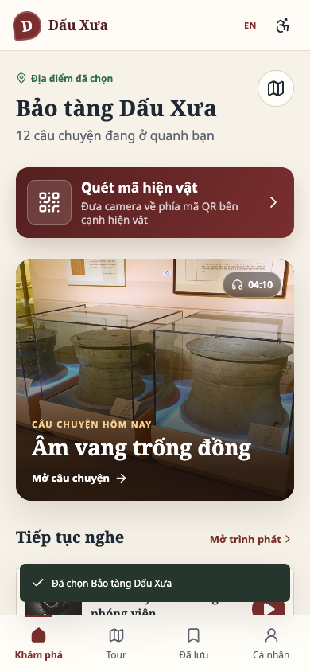{ width=42% } 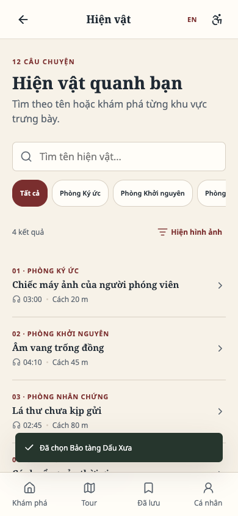{ width=42% }

Hình 12. Trạng thái hệ thống và chế độ danh sách đơn giản sau khi rà soát heuristic.

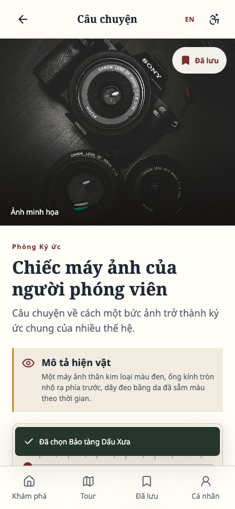{ width=42% } 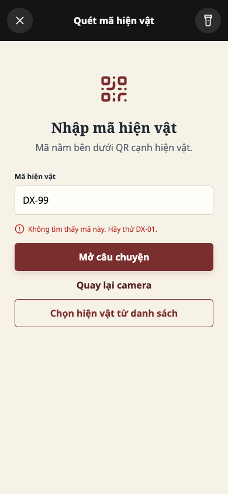{ width=42% }

Hình 13. Trình phát và trạng thái phục hồi lỗi ở bản sau khi chỉnh sửa.

## A.4. Các thay đổi giúp người dùng như thế nào?

Minh có thể tìm hiện vật và mở câu chuyện nhanh hơn. Hương thấy rõ thời lượng, giá và số điểm trước khi chọn tour. Nam có thể dùng danh sách, bàn phím và nội dung thay thế thay vì phải phụ thuộc vào camera. Đây đều là những tác vụ chính đã xuất hiện trong phần kịch bản và HTA.

## A.5. Những điểm cần kiểm tra thêm

Bản hiện tại mới được kiểm tra về hoạt động của giao diện, chưa được thử với người dùng thật hoặc trình đọc màn hình. Lần kiểm tra tiếp theo cần xem người dùng có tìm thấy danh sách hiện vật, thao tác được bằng bàn phím hoặc VoiceOver/TalkBack, hiểu thông báo lỗi và biết cách tiếp tục hay không.

# Tài liệu tham khảo

Apple App Store (2026a), *Smartify: Arts and Culture*. Truy cập ngày 19/09/2026 tại <https://apps.apple.com/gb/app/smartify-arts-and-culture/id1102736524>.

Apple App Store (2026b), *Connects: Arts+Culture*. Truy cập ngày 19/09/2026 tại <https://apps.apple.com/us/app/connects-arts-culture/id1476456847>.

Bloomberg Connects (2026), *Bloomberg Connects*. Truy cập ngày 12/09/2026 tại <https://www.bloombergconnects.org/>.

Nielsen, Jakob (1994, rà soát năm 2024), *10 Usability Heuristics for User Interface Design*. Nielsen Norman Group. Truy cập ngày 03/10/2026 tại <https://www.nngroup.com/articles/ten-usability-heuristics/>.

Smartify (2026), *Smartify: Arts and Culture*. Truy cập ngày 12/09/2026 tại <https://play.google.com/store/apps/details?id=com.mobgen.smartify>.

Vi Chi Thanh (2026a), *Week 2: Introduction to User-Centred Design Methods*. Tài liệu môn học, University of Information Technology và Birmingham City University.

Vi Chi Thanh (2026b), *Week 3: Introduction to Accessibility and Inclusive Design*. Tài liệu môn học, University of Information Technology và Birmingham City University.

W3C Web Accessibility Initiative (2024a), *How People with Disabilities Use the Web*. Truy cập ngày 12/09/2026 tại <https://www.w3.org/WAI/people-use-web/>.

W3C Web Accessibility Initiative (2024b), *Involving Users in Web Projects for Better, Easier Accessibility*. Truy cập ngày 12/09/2026 tại <https://www.w3.org/WAI/planning/involving-users/>.
